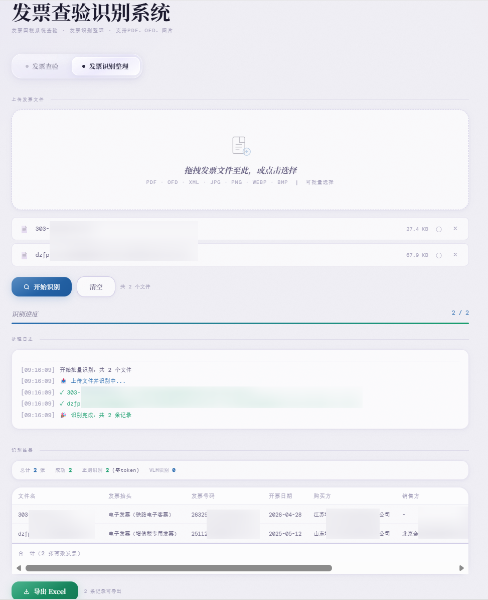
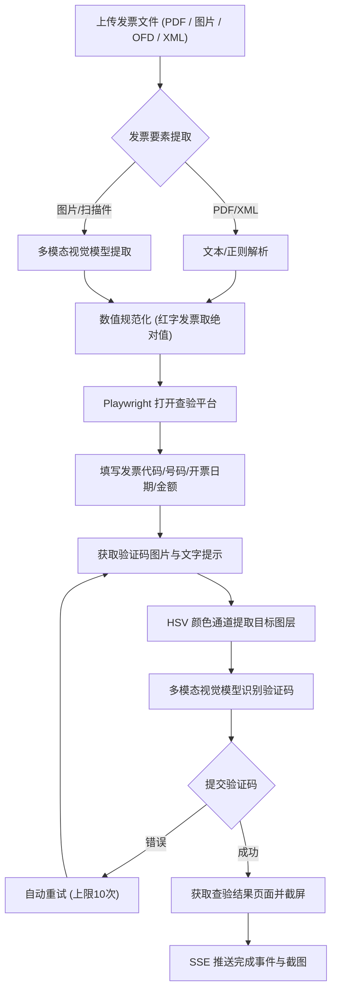
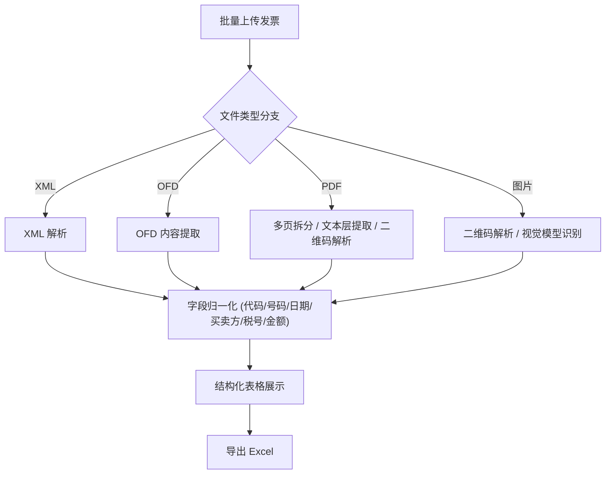

# InvoiceChecker 发票查验与识别系统

基于 Python、Playwright 与多模态大模型的发票查验与结构化提取系统。支持全国增值税发票查验平台官方核验与发票批量识别归档。

---

## 功能特性

- **官方查验核验**：通过 Playwright 连接全国增值税发票查验平台，自动填写发票要素并获取查验结果截图。
- **验证码识别**：通过 HSV 颜色空间提取目标颜色文字图层，并结合多模态视觉模型进行比对识别，支持自动重试。
- **票种支持**：已支持增值税专用发票、增值税普通发票、全电发票（数电票）、红字负数发票及铁路电子客票。
  - **增值税专票/普票**：标准四要素提取与校验。
  - **全电发票（数电票）**：自动提取 20 位发票号码与价税合计金额。
  - **红字发票**：金额自动转换为绝对值以适配平台填报规范。
  - **铁路电子客票**：支持车次、日期与票价信息提取。
  - **多格式支持**：支持 PDF（含单文件多页）、OFD、XML 及常见图片格式。
- **流式进度回传**：采用 Server-Sent Events (SSE) 协议实时传输查验步骤与状态。
- **多模型支持**：默认支持智谱 GLM-4V-Flash 模型，亦可配置阿里百炼 (Qwen-VL)、腾讯云 OCR 等接口。

---

## 界面截图

### 1. 发票查验页面


### 2. 发票识别与整理页面


---

## 系统流程

### 1. 发票查验流程 (POST /api/verify)



### 2. 批量发票识别整理流程 (POST /api/recognize)



---

## 技术栈

| 模块 | 技术选型 | 说明 |
| :--- | :--- | :--- |
| **后端服务** | Python 3.10+ / Flask | Web 服务与 SSE 流式传输 |
| **浏览器自动化** | Playwright (Python) | Headless Chromium 自动化查验 |
| **视觉模型** | 智谱 GLM-4V-Flash / Qwen-VL | 票面字段提取与验证码识别 |
| **图像处理** | OpenCV / NumPy | HSV 颜色空间过滤与图像预处理 |
| **文档处理** | PyMuPDF (fitz) / easyofd | PDF 文本提取与 OFD 页面转换 |
| **数据处理** | Pandas / OpenPyXL | 发票数据归档与 Excel 导出 |

---

## 快速开始

### 1. 环境准备

- **操作系统**：Windows 10/11、macOS、Linux (Ubuntu 20.04+)
- **Python 版本**：Python 3.10 – 3.12

### 2. 安装依赖

克隆代码并创建虚拟环境：

```bash
git clone https://github.com/Nihiliaan/invoicechecker.git
cd invoicechecker

# 创建并激活虚拟环境 (Linux / macOS)
python3 -m venv venv
source venv/bin/activate

# Windows PowerShell:
# python -m venv venv
# .\venv\Scripts\Activate.ps1

# 安装 Python 依赖
pip install -r requirements.txt
```

安装 Playwright 浏览器内核：

```bash
playwright install chromium
# Linux 无图形环境需补充系统依赖：
playwright install-deps chromium
```

---

### 3. 环境配置 (`.env`)

复制配置文件模板：

```bash
cp .env.example .env
```

编辑 `.env` 文件，配置识别引擎与浏览器参数：

```ini
# 识别引擎选择 (可选: zhipu / aliyun / tencent)
OCR_PROVIDER=zhipu

# 智谱开放平台 API Key (https://bigmodel.cn/)
ZHIPU_API_KEY=your_zhipu_api_key_here

# 浏览器配置
HEADLESS=true
# Chromium 可执行文件路径（留空则自动检测）
CHROMIUM_EXECUTABLE_PATH=/snap/bin/chromium

# 可选：阿里云百炼配置
ALIBABA_API_KEY=your_alibaba_key
VLM_MODEL=qwen3-vl-flash

# 可选：腾讯云 OCR 配置
TENCENTCLOUD_SECRET_ID=your_secret_id
TENCENTCLOUD_SECRET_KEY=your_secret_key
TENCENTCLOUD_REGION=ap-guangzhou
```

---

### 4. 运行服务

```bash
python invoice_app.py
```

服务默认运行在 `http://localhost:9896`。

---

## Linux 生产环境部署 (Systemd)

推荐使用 Systemd 管理后台服务：

1. **创建服务文件** `/etc/systemd/system/invoicechecker.service`：

```ini
[Unit]
Description=InvoiceChecker Service
After=network.target

[Service]
User=app
Group=app
WorkingDirectory=/opt/invoicechecker
Environment="PATH=/opt/invoicechecker/venv/bin:/usr/local/bin:/usr/bin:/bin"
ExecStart=/opt/invoicechecker/venv/bin/python3 invoice_app.py
Restart=always
RestartSec=3

[Install]
WantedBy=multi-user.target
```

2. **启动并启用服务**：

```bash
sudo systemctl daemon-reload
sudo systemctl enable invoicechecker
sudo systemctl start invoicechecker

# 查看运行状态
sudo systemctl status invoicechecker
```

---

## API 接口说明

### 1. 发票查验接口 (SSE)
- **路径**：`POST /api/verify`
- **请求类型**：`multipart/form-data`
- **参数**：`file`（发票文件，支持 PDF / JPG / PNG / OFD / XML）
- **响应格式**：`text/event-stream`（Server-Sent Events）

#### 协议字段定义

| 字段名称 | 类型 | 说明 | 取值范围 |
| :--- | :--- | :--- | :--- |
| `step` | String | 当前步骤标识（纯英文） | `"parse"`（发票解析）、`"open_browser"`（打开平台）、`"fill_form"`（填写表单）、`"captcha"`（验证码识别）、`"fetch_result"`（获取结果）、`"done"`（完成） |
| `status` | Boolean | 步骤执行结果（仅在步骤完成或失败时返回） | 成功为 `true`，失败为 `false`。步骤进行中不包含此字段。 |
| `data` | Object / String / null | 业务数据 | 1. 当 `step: "parse"` 且 `status: true` 时，返回发票结构化 JSON；<br>2. 当 `step: "done"` 时，成功返回截图 DataURL，失败返回 `null`；<br>3. 其他步骤不包含此字段。 |

---

#### 响应示例：查验成功

```http
HTTP/1.1 200 OK
Content-Type: text/event-stream
Cache-Control: no-cache
Connection: keep-alive

data: {"step": "parse"}

data: {"step": "parse", "status": true, "data": {"invoice_title": "电子发票（增值税普通发票）", "invoice_code": "011002000711", "invoice_number": "26319166100014538083", "issue_date": "2026-10-31", "amount_ex_tax": 626.0, "tax_amount": 0.0, "total_amount": 626.0, "check_code": "12345678901234567890", "buyer_name": "北京科技有限公司", "buyer_tax_id": "91110108MA00XXXXXX", "seller_name": "上海商贸有限公司", "seller_tax_id": "91310115MA00YYYYYY", "items": ["技术服务费"], "total_words": "陆佰贰拾陆元整", "remarks": "", "issuer": "张三"}}

data: {"step": "open_browser"}

data: {"step": "open_browser", "status": true}

data: {"step": "fill_form"}

data: {"step": "fill_form", "status": true}

data: {"step": "captcha"}

data: {"step": "captcha", "status": true}

data: {"step": "fetch_result"}

data: {"step": "fetch_result", "status": true}

data: {"step": "done", "status": true, "data": "data:image/png;base64,iVBORw0KGgoAAAANSUhEUgAABQAA..."}
```

---

#### 响应示例：解析失败

```http
HTTP/1.1 200 OK
Content-Type: text/event-stream
Cache-Control: no-cache
Connection: keep-alive

data: {"step": "parse"}

data: {"step": "parse", "status": false}

data: {"step": "done", "status": false, "data": null}
```

---

#### 响应示例：查验失败（如验证码超限）

```http
HTTP/1.1 200 OK
Content-Type: text/event-stream
Cache-Control: no-cache
Connection: keep-alive

data: {"step": "parse"}

data: {"step": "parse", "status": true, "data": {"invoice_title": "电子发票（增值税普通发票）", "invoice_code": "", "invoice_number": "26319166100014538083", "issue_date": "2026-10-31", "amount_ex_tax": 626.0, "tax_amount": 0.0, "total_amount": 626.0, "check_code": "", "buyer_name": "北京科技有限公司", "buyer_tax_id": "", "seller_name": "上海商贸有限公司", "seller_tax_id": "", "items": [], "total_words": "", "remarks": "", "issuer": ""}}

data: {"step": "open_browser"}

data: {"step": "open_browser", "status": true}

data: {"step": "fill_form"}

data: {"step": "fill_form", "status": true}

data: {"step": "captcha"}

data: {"step": "captcha", "status": false}

data: {"step": "done", "status": false, "data": null}
```

---

### 2. 批量发票识别接口
- **路径**：`POST /api/recognize`
- **请求类型**：`multipart/form-data`
- **参数**：`files[]`（支持单张或批量发票文件）
- **响应**：结构化 JSON，包含发票代码、号码、日期、购销双方信息、明细列表及金额税额汇总。

### 3. Excel 导出接口
- **路径**：`POST /api/recognize/export`
- **请求类型**：`application/json`
- **响应**：导出发票明细 Excel 文件（`.xlsx`）。

---

## 故障排查与常见问题

### 1. 验证码调试缓存
查验过程中生成的图像缓存保存在 `cache/captcha_debug/` 目录下，包含原图与过滤图层，用于排查识别问题。

### 2. 常见问题
- **Linux 环境提示 Chromium 缺失**：
  检查 `which chromium` 路径，并在 `.env` 中指定 `CHROMIUM_EXECUTABLE_PATH`；运行 `playwright install-deps chromium` 安装系统依赖。
- **红字发票格式问题**：
  系统已自动对红字发票金额取绝对值，适配查验平台输入规则。
- **平台查验次数限制**：
  全国增值税发票查验平台限制单张发票每天查验不超过 5 次。

---

## 免责声明

1. 本项目仅供学习、研究与合规的内部发票整理使用。
2. 自动化查验过程应遵循全国增值税发票查验平台的相关服务规范。

---

## 致谢 (Acknowledgments)

本项目发票查验的相关思路启发自开源项目 [shawnxustudio/invoicechecker](https://github.com/shawnxustudio/invoicechecker)，在此对原作者的开源工作表示感谢。
